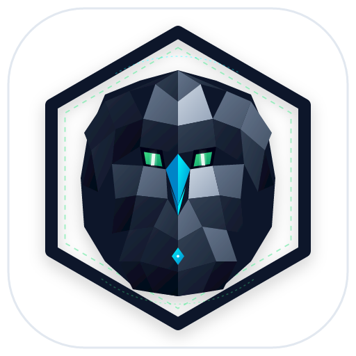
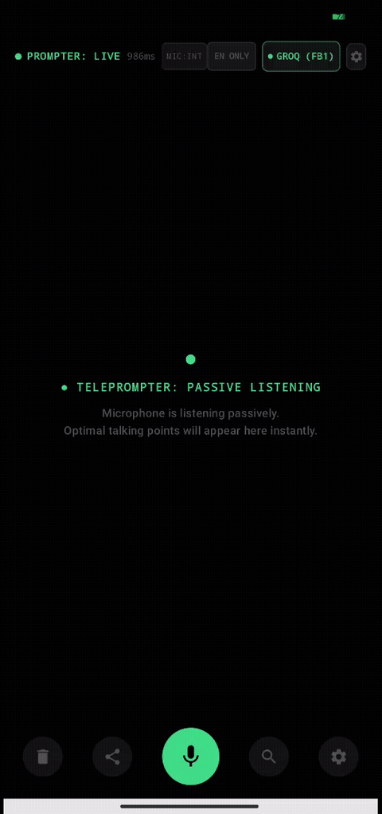
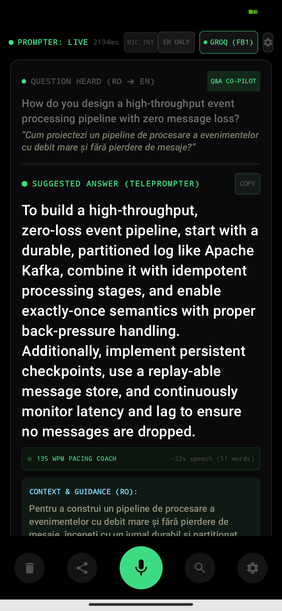
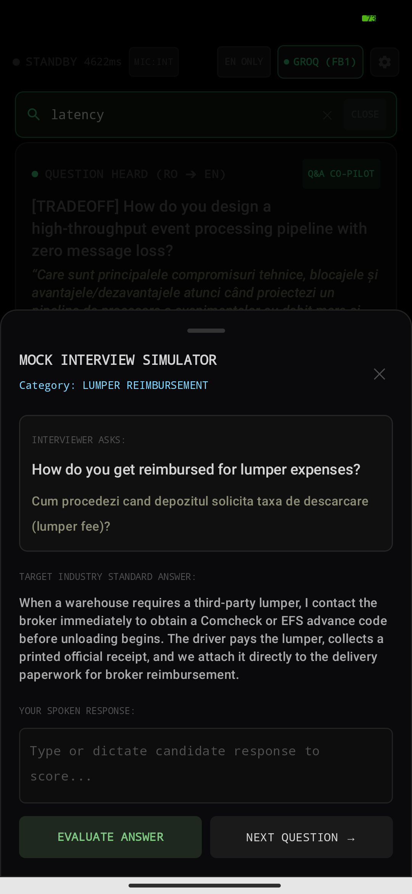
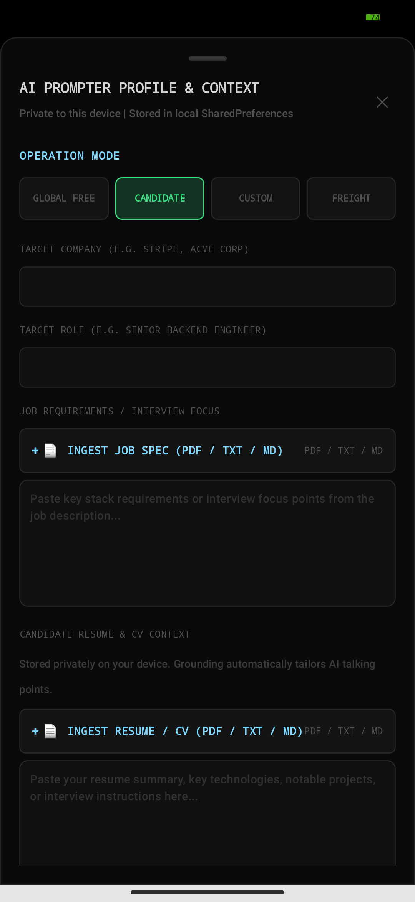
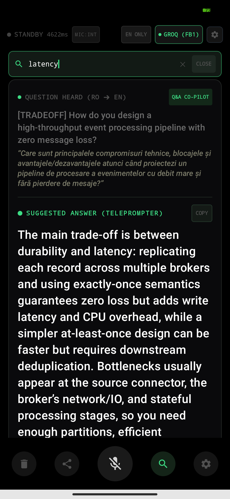
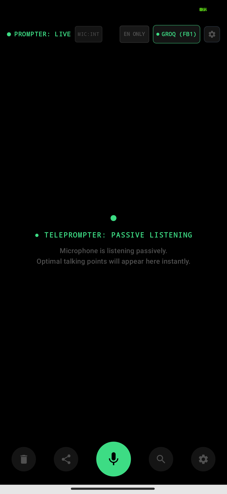

<div align="center">



# Stealth Voice Copilot

**Discreet real-time voice teleprompter and interview copilot for Android.**

[](https://android.com)
[](https://kotlinlang.org)
[](https://developer.android.com/jetpack/compose)
[](https://onnxruntime.ai)
[](LICENSE)

<br/>

<p align="center">
  
</p>

<p align="center">
  
  
  
</p>

<p align="center">
  
  
</p>

</div>

## Overview

Stealth Voice Copilot is a discreet real-time voice teleprompter and assistant for Android, engineered for live technical interviews, negotiations, and professional conversations. The application continuously listens to interlocutor questions, transcribes speech, normalizes domain terminology, and displays structured English teleprompter responses on an AMOLED true black display, accompanied by source-language coaching notes.

The system supports both cloud-accelerated inference (Google Gemini and Groq Cloud LPU) and local on-device execution (Google Tensor NPU and MediaPipe LLM), operating with graceful offline fallback when no active network is available.

## Core Capabilities

* **Embedded Web Teleprompter Mirror (LAN `:8765`):**
  * Built-in HTTP and WebSocket server running directly inside the Android process.
  * Streams live dialogue turns and teleprompter answers to any laptop browser on the local network (`http://<phone-ip>:8765`).
  * Optimized AMOLED dark UI designed to sit directly beneath a laptop webcam, matching eye level during video calls.
  * Bidirectional synchronization: allows typing queries or scenario tests directly from the laptop browser into the phone engine.

* **On-Device Document & CV/Resume Ingestion:**
  * Extracts text from PDF, TXT, Markdown, and CSV files directly on-device using PDFBox-Android.
  * Stored in private device SharedPreferences to ground interview answers in actual candidate work history and job requirements.
  * Zero third-party cloud ingestion pipeline, maintaining absolute privacy for personal data.

* **Follow-Up Micro-Actions:**
  * Quick 1-tap expansion buttons beneath each prompter card: `+ Example`, `+ Tradeoff`, `Simpler`, `Deep Dive`.
  * Generates targeted secondary turns in sub-500ms using the active cloud or local LLM engine.

* **Keyword Anchors Display Mode:**
  * Alternative prompter delivery style formatting answers into high-glance bracketed badges (`[Anchor 1] [Anchor 2] [Anchor 3]`).
  * Enables glance-and-speak conversational flow rather than reciting complete sentences.

* **Proximity Sensor Palm Blackout:**
  * Hardware proximity sensor listener instantly blanks the screen to pure `#000000` AMOLED black and mutes prompter audio when a palm or notepad covers the top bezel.
  * Screen returns to active state immediately when the sensor clears.

* **135 WPM Speaking Pacing Coach:**
  * Discreet pulsing cadence indicator bar set to standard 135 words per minute broadcast speech pace.
  * Displays estimated speaking duration in seconds based on answer word count.

* **In-Session History Search & Markdown Export:**
  * Instant text search bar filtering turns by interviewer transcript or teleprompter answers in real time.
  * Clean Markdown export formatted with session date, candidate role, questions, answers, and latency metrics copied directly to clipboard.

* **Dual-Mode Speech Recognition with Instant Toggle:**
  * **RO➔EN (Romanian to English):** Routes speech capture directly to Google Speech Services (`ro-RO`) cloud acoustic models. Accurately transcribes spoken Romanian without vendor ROM offline pack limitations, translates the inquiry to English, and synthesizes English teleprompter talking points plus Romanian coaching summaries.
  * **EN ONLY (English Direct):** Isolates speech recognition strictly to `en-US`. Eliminates cross-lingual acoustic bleed, ensuring English phonemes (such as "hi") are never misclassified as Romanian loanwords (such as "hai").
  * **Zero-Lockup UI Switcher:** One-tap pill in the top status bar switches active speech models in under 50ms without audio HAL teardown or thread blocking.

* **Cross-Lingual Acoustic De-Bleeding:**
  * **Lexicon Normalizer:** Sub-millisecond regex normalization in `FreightLexiconNormalizer` resolving frequent speech recognition phonetic artifacts (`hai how are...` -> `hi how are...`, `uai...` -> `why...`, `helau` -> `hello`).
  * **LLM Speech Reconstruction:** Automated ASR repair protocol in `PromptBuilder` instructing the reasoning model to reconstruct the authentic spoken utterance in `transcript_en` and `transcript_ro` before generating the response.

* **Multi-Tier Hierarchical Inference Engine:**
  * **Google Gemini (Priority 1):** Primary cloud inference using Google AI Studio (`gemini-2.5-flash`, `gemini-2.0-flash`) with structured JSON mode and dual API key failover.
  * **Groq Cloud LPU (Fallback 1):** Sub-250ms ultra-low latency failover provider (`llama-3.3-70b-versatile`, `llama-3.1-8b-instant`).
  * **Gemini Alternative Flash (Fallback 2):** Secondary variant retry before falling back to local hardware.
  * **On-Device Local Neural Model (Fallback 3):** Executes quantized models (Llama 3.2 1B or Gemma 2 2B) natively on Google Tensor G1 NPU/GPU using MediaPipe Tasks GenAI.
  * **Offline Mode:** Instant bypass directly to the on-device model whenever internet connectivity is unavailable.

* **Domain Grounding and Custom Profiles:**
  * **Candidate Technical Interview:** Grounding for software engineering, system design, and AI architectures, with customizable candidate background, target company, target role, and job description requirements.
  * **General Conversational Assistant:** Open-ended conversational mode without domain constraints.
  * **US Freight Dispatching and Logistics:** Preloaded with commercial transportation practices (Rate Confirmations, BOL, POD, Factoring NOA, Detention billing, Layover, and TONU).
  * **Custom System Prompt:** Direct user-defined persona and instructions.
  * **Prompter Styles:** Configurable between Anchor Bullets (conversational hook sentence with 2 to 3 bullet points) and Full Broadcast Sentences (fluent verbatim read-aloud text).

* **Multilingual Coaching Languages:**
  * Supports real-time coaching translation and summaries in Romanian, Spanish, German, French, Italian, Russian, Ukrainian, Polish, Portuguese, Turkish, and English.

* **Covert Display and Controls:**
  * **AMOLED True Black Lockscreen:** Renders over the lockscreen with `#000000` background to minimize illumination and preserve battery.
  * **Floating System HUD:** Secondary transparent overlay for video conference applications (Zoom, Microsoft Teams, Google Meet).
  * **Covert Whisper Earpiece:** Whispers key talking points directly into connected Bluetooth earbuds (Pixel Buds) with zero speaker leakage.
  * **Covert Hardware Controls:** Rapid Volume Up double-tap triggers emergency panic wipe of session RAM and disk cache; Volume Down long-press toggles coaching notes.
  * **Glance Syntax Highlighting:** High-contrast color hierarchy with English answers in `#D0D0D0` (18sp bold), interviewer questions in `#666666`, and coaching notes in emerald/khaki italic.

## System Architecture

```
[Interviewer Audio]
       |
       v
+-------------------------------------------------------+
| Audio Ingestion & Acoustic Preprocessing              |
| (16kHz PCM, AEC, Hardware Noise Suppression)          |
+--------------------------+----------------------------+
                           |
                           v
+-------------------------------------------------------+
| Speech Recognition Engine                             |
|  - EN ONLY mode: On-device / cloud en-US isolator     |
|  - RO➔EN mode: Google Cloud ro-RO acoustic decoder    |
+--------------------------+----------------------------+
                           | Raw Transcript
                           v
+-------------------------------------------------------+
| Lexicon Normalizer & Phonetic De-Bleed Filter         |
| (Sub-1ms regex cleanup of cross-lingual artifacts)    |
+--------------------------+----------------------------+
                           | Normalized Text
                           v
+-------------------------------------------------------+
| Hierarchical LLM Inference Router                     |
|  1. Google Gemini (P1, gemini-2.5-flash / dual keys)  |
|  2. Groq Cloud LPU (FB1, llama-3.3-70b-versatile)     |
|  3. Gemini Alternative Flash (FB2)                    |
|  4. Local MediaPipe GenAI (FB3 / Offline, Llama 3.2)  |
+--------------------------+----------------------------+
                           | CopilotTurn (JSON)
                           v
+-------------------------------------------------------+
| Presentation Layer                                    |
|  - AMOLED True Black Lockscreen (StealthActivity)     |
|  - Floating Mini HUD Overlay (StealthOverlayService)  |
|  - Bluetooth Earpiece Whisper (AudioPrompter)         |
+-------------------------------------------------------+
```

## Hardware and System Requirements

* **Primary Device:** Google Pixel 6 Pro (Google Tensor G1, 12 GB RAM)
* **Minimum Android Version:** Android 14 (API level 34)
* **Target Android Version:** Android 15 (API level 35) or Android 16 (API level 36)
* **Required Permissions:**
  * `RECORD_AUDIO`: Continuous local PCM stream capture
  * `FOREGROUND_SERVICE` and `FOREGROUND_SERVICE_MICROPHONE`: Background audio session persistence
  * `SYSTEM_ALERT_WINDOW`: Floating HUD overlay across applications
  * `WAKE_LOCK`: Retaining CPU inference states during active speech

## Project Structure

```
stealth-voice-copilot/
├── app/
│   ├── src/main/
│   │   ├── java/com/copilot/stealth/
│   │   │   ├── data/            # MVI models, state machine, freight glossary
│   │   │   ├── engine/audio/    # AudioRecord, Silero VAD, AudioTestBench
│   │   │   ├── engine/stt/      # Sherpa-ONNX STT and lexicon normalizer
│   │   │   ├── engine/llm/      # MediaPipe LLM and response parsers
│   │   │   ├── service/         # Foreground and Quick Settings tile services
│   │   │   └── ui/              # Jetpack Compose AMOLED lockscreen and HUD
│   │   └── res/                 # Vector drawables, themes, strings
│   └── src/test/                # Unit tests for domain logic and parsers
├── docs/                        # Architecture, hardware setup, logistics guide
├── PLAN.md                      # Detailed technical specification
└── README.md                    # Project overview and quick start
```

## Building and Verification

### Prerequisites
* JDK 21
* Android SDK (API 34+)
* CMake and Android NDK (for native ONNX components)

### Build Commands
```bash
# Build debug APK
./gradlew assembleDebug

# Run unit tests
./gradlew testDebugUnitTest

# Install to connected Pixel 6 Pro
adb install -r app/build/outputs/apk/debug/app-debug.apk
```

## Documentation

* [Architecture Specification](docs/ARCHITECTURE.md): Detailed subsystem contracts and signal flows.
* [Freight Logistics Knowledge Guide](docs/FREIGHT_LOGISTICS_GUIDE.md): Reference data for freight dispatch terminology and standard answers.
* [Hardware and Gestures Setup](docs/HARDWARE_SETUP.md): Step-by-step setup for Pixel Quick Tap, Quick Settings Tile, and lockscreen overlay.
* [Testing and Verification Protocol](docs/TESTING_AND_VERIFICATION.md): Audio bench testing, latency benchmarks, and scenario evaluations.

## License

MIT License. See [LICENSE](LICENSE) for details.
